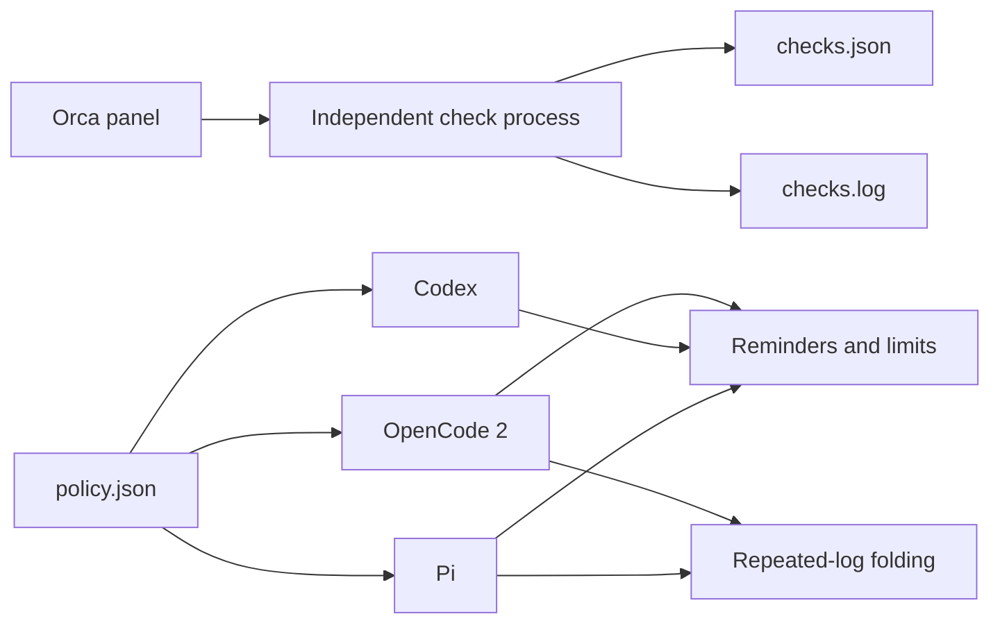

<div align="center">
  <h1>HarnessPro</h1>
  <p><strong>Shared tool budgets for OpenCode 2, Codex, and Pi—with an Orca control panel.</strong></p>

  <p>
    <a href="https://github.com/wzasd/HarnessPro/tree/v0.1.0"></a>
    <a href="https://github.com/wzasd/HarnessPro/blob/main/LICENSE"></a>
    
  </p>

  <p><a href="README.md">English</a> · <a href="docs/i18n/zh-CN.md">简体中文</a> · <a href="docs/i18n/ja.md">日本語</a></p>
</div>

## Three agents walk into a repository

One reads the same file twelve times. One downloads a novel-length build log. One keeps calling tools after the tests pass.

HarnessPro gives all three the same budget, a gentle nudge to wrap up, and a firm stop when the tool meter runs out. It also gives you an Orca panel to run checks without babysitting a terminal.

This is a third-party engineering project inspired by the HarnessPro paper. It is **not** the authors' official implementation, and it does not claim their benchmark results.

## What is in the toolbox?

| Component | What it does today | What it does not do yet |
| --- | --- | --- |
| Orca plugin | Start, inspect, and stop checks; show completion notifications | No stable-panel guarantee while the plugin API is experimental |
| Shared policy | Lite, Medium, and Heavy tool budgets | No automatic profile selection |
| OpenCode 2 adapter | Phase reminders, hard limits, repeated-log folding | No automatic model routing |
| Codex adapter | Phase reminders, hard limits, parallel-call accounting | No log folding; Codex hooks cannot rewrite tool output |
| Pi adapter | Phase reminders, hard limits, log folding, in-session profile switching | No automatic model routing |

The short version: **less wandering, more finishing.**

## The 30-second quick start

### Requirements

- Linux
- Node.js 22+
- Python 3.12+
- Orca 1.4.0+
- OpenCode 2, Codex, or Pi, as needed

### Install

1. Clone and install the test dependencies:

   ```bash
   git clone git@github.com:wzasd/HarnessPro.git
   cd HarnessPro
   npm install
   ```

2. Link the plugin and adapters:

   ```bash
   npm run install:local
   ```

3. Open **Settings → Plugins** in Orca.
4. Choose **Install from local path** and select this project directory.
5. Review the requested capabilities and enable HarnessPro.

The installer backs up existing files before creating symlinks. Backup suffixes are `.backup-before-project` and `.backup-before-harnesspro-project`.

## Pick a budget, not a mystery

Start your agent with a profile:

```bash
harnesspro lite opencode2 --standalone
harnesspro medium codex
harnesspro heavy pi
```

| Profile | Economy | Convergence | Hard limit | Good starting point |
| --- | ---: | ---: | ---: | --- |
| Lite | 8 | 14 | 22 | Small, well-scoped tasks |
| Medium | 14 | 26 | 44 | Everyday coding work |
| Heavy | 20 | 36 | 60 | Harder investigations |

These are local starting values, not recommendations from the paper. Tune them against pass rate and cost on your own tasks.

Pi users can also switch during a session:

```text
/harnesspro lite
/harnesspro medium
/harnesspro heavy
/harnesspro off
```

No profile means no budget enforcement.

## Run checks from Orca

Use the panel buttons, or type:

```bash
harnesspro checks start
harnesspro checks status
harnesspro checks stop
```

Checks run in a separate process. Closing the panel does not stop them.

```text
~/.local/state/harnesspro/checks.json
~/.local/state/harnesspro/checks.log
```

## How the pieces fit



Plugin code, policy, and job records live separately. Updating the plugin does not delete your policy or logs.

## Paper trail

The project name and budget-profile idea come from this paper:

**HarnessPro: Recursive Harness Self-Improvement with Pareto Optimization for Performance-Cost Trade-offs**

- **Authors:** Zhuoshi Pan, ZhiYuan Feng, Yukuo Cen, Honglin Lin, Junru Lu, Zhongxia Chen, Shuo Yang, H. Vicky Zhao, Jie Tang
- **Paper:** [arXiv:2610.26770v2](https://arxiv.org/abs/2610.26770v2), published 2026-10-20
- **DOI:** [10.48550/arXiv.2610.26770](https://doi.org/10.48550/arXiv.2610.26770)
- **Status:** Under review
- **Official code:** [pzs19/HarnessPro](https://github.com/pzs19/HarnessPro)

| Source | What it contains |
| --- | --- |
| Paper | Label-free test synthesis, multi-agent harness evolution, performance–cost Pareto selection |
| Official repository | Nine harness artifacts and evaluation code for three benchmarks |
| This repository | An Orca plugin, shared budgets, agent adapters, and a check coordinator |

The paper uses Lite, Medium, and Heavy for performance–cost operating points. This repository currently uses the same names for tool-budget profiles only. It does not reproduce the paper's Pareto frontier or experimental results.

## Marketplace installation

1. Open **Settings → Plugins → Marketplace sources** in Orca.
2. Add:

   ```text
   https://github.com/wzasd/HarnessPro.git
   ```

3. Set the ref to `main`.
4. Install `harnesspro.orca` and review its capabilities.
5. Enable the plugin.

The marketplace index currently points to `v0.1.0`.

## Updates

For a local symlink installation:

```bash
git pull
npm install
npm test
```

No second install is needed; the links still point to the project.

Marketplace installations require an update confirmation in Orca. Policy and job records stay outside versioned plugin directories.

## Development

### Project map

```text
orca-plugin.json       Orca manifest
orca-marketplace.json  Marketplace index
main.mjs               Orca worker
panel.html             Orca panel
coordinator.mjs        Independent check process
core.mjs               Shared OpenCode 2 and Pi logic
policy.json            Shared budgets
adapters/              OpenCode 2, Codex, and Pi adapters
scripts/               Local installation and registration
```

### Test

```bash
npm test
```

The suite covers policy loading, parallel accounting, log folding, process lifecycle, Orca worker behavior, Codex hook input/output, and legacy hook-path migration.

### Release a new version

1. Update `package.json` and `orca-plugin.json`.
2. Update the ref in `orca-marketplace.json`.
3. Run `npm test`.
4. Commit and create a matching Git tag.
5. Push the commit and tag.

## Not in the box yet

- Automatic model and reasoning-effort routing.
- Multi-agent trajectory analysis, planning, editing, and test synthesis.
- Candidate evaluation with fixed task sets and cost-aware selection.
- Automatic replacement of the active policy.

Those features belong to the broader HarnessPro research direction. This repository currently provides the budget and orchestration foundation, not the complete self-evolution loop.

## Translations

- [English](README.md) — canonical version
- [简体中文](docs/i18n/zh-CN.md)
- [日本語](docs/i18n/ja.md)

English is the maintenance source of truth. Update translations in the same pull request when behavior or setup changes.

## License

[MIT](LICENSE)
