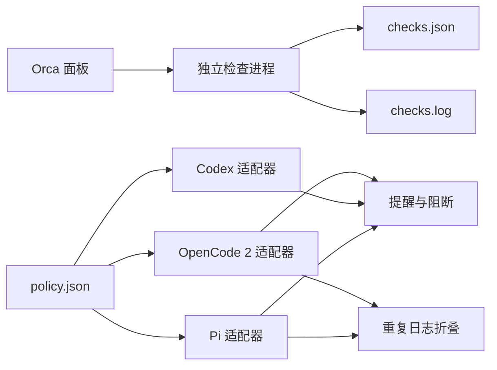

<div align="center">
  <h1>HarnessPro</h1>
  <p>让 OpenCode 2、Codex 和 Pi 共用工具预算，并在 Orca 中运行检查。</p>

  <p>
    <a href="https://github.com/wzasd/HarnessPro/releases/tag/v0.1.0">
      
    </a>
    <a href="https://github.com/wzasd/HarnessPro/blob/main/LICENSE">
      
    </a>
    
    
    
  </p>
</div>

[快速开始](#快速开始) · [当前功能](#当前功能) · [论文来源](#论文来源) · [开发与测试](#开发与测试)

> **项目关系**：本仓库是第三方 Orca 插件，参考 HarnessPro 论文的 Harness 思路。当前版本只覆盖共享预算、运行时钩子和检查协调，不包含论文中的多 Agent 自动进化算法。

## 论文来源

本项目参考以下论文和官方仓库。

| 项目 | 内容 |
| --- | --- |
| 论文标题 | **HarnessPro: Recursive Harness Self-Improvement with Pareto Optimization for Performance-Cost Trade-offs** |
| 作者 | Zhuoshi Pan、ZhiYuan Feng、Yukuo Cen、Honglin Lin、Junru Lu、Zhongxia Chen、Shuo Yang、H. Vicky Zhao、Jie Tang |
| arXiv | [2610.26770v2](https://arxiv.org/abs/2610.26770v2)，2026-10-20 |
| DOI | [10.48550/arXiv.2610.26770](https://doi.org/10.48550/arXiv.2610.26770) |
| 论文状态 | Under review |
| 官方代码 | [pzs19/HarnessPro](https://github.com/pzs19/HarnessPro) |
| 本仓库 | [wzasd/HarnessPro](https://github.com/wzasd/HarnessPro)，由 wzasd 维护，与论文作者无关 |

### 论文、官方仓库和本仓库的区别

| 对象 | 主要内容 |
| --- | --- |
| 论文 | 无标签测试合成、多 Agent Harness 进化、性能与成本帕累托选择 |
| 官方仓库 | 3 个基准的 9 套 Harness 配置和评测代码 |
| 本仓库 | Orca 插件、共享预算、OpenCode 2/Codex/Pi 适配器和检查协调器 |

论文提出的 Lite、Medium、Heavy 用于表示不同的性能与成本取舍。本仓库当前借用这 3 个名称表示工具预算档位，不表示已经复现论文的帕累托前沿或实验结果。

## 当前功能

| 组件 | 已支持 | 当前边界 |
| --- | --- | --- |
| Orca 插件 | 运行检查、查看状态、停止检查、完成通知 | 插件 API 仍处于实验阶段 |
| 共享策略 | Lite、Medium、Heavy 3 档预算 | 不会自动选择档位 |
| OpenCode 2 | 阶段提醒、超限阻断、重复日志折叠 | 启动前选择档位 |
| Codex | 阶段提醒、超限阻断、并行调用计数 | 官方 Hook 不支持折叠日志 |
| Pi | 阶段提醒、超限阻断、重复日志折叠、会话内切换 | 不支持自动模型路由 |

## 工作方式



策略、插件代码和任务记录分开保存。更新插件不会删除 `policy.json` 或检查日志。

## 快速开始

### 环境要求

- Linux。
- Node.js 22 或更高版本。
- Python 3.12 或更高版本。
- Orca 1.4.0 或更高版本。
- 按需安装 OpenCode 2、Codex 或 Pi。

### 本地安装

1. 克隆项目并安装测试依赖：

   ```bash
   git clone git@github.com:wzasd/HarnessPro.git
   cd HarnessPro
   npm install
   ```

2. 链接插件和适配器：

   ```bash
   npm run install:local
   ```

3. 打开 Orca 的“设置 → Plugins”。
4. 刷新插件并查看 HarnessPro 权限说明。
5. 启用 HarnessPro。

安装脚本会备份已有文件，再创建符号链接。备份后缀为 `.backup-before-project` 和 `.backup-before-harnesspro-project`。

## 使用

### 选择预算档位

启动 Agent 前选择档位：

```bash
harnesspro lite opencode2 --standalone
harnesspro medium codex
harnesspro heavy pi
```

Pi 会话内也可以切换：

```text
/harnesspro lite
/harnesspro medium
/harnesspro heavy
/harnesspro off
```

未选择档位时，预算限制默认关闭。

### 修改共享预算

编辑项目根目录的 `policy.json`：

| 档位 | Economy | Convergence | 工具上限 |
| --- | ---: | ---: | ---: |
| Lite | 8 | 14 | 22 |
| Medium | 14 | 26 | 44 |
| Heavy | 20 | 36 | 60 |

这些数值是本地初始值，不是论文推荐值。修改前宜记录真实任务的通过率和成本。

### 运行 Orca 检查

HarnessPro 面板提供“运行检查”“查看状态”“停止检查”。

终端也可以执行：

```bash
harnesspro checks start
harnesspro checks status
harnesspro checks stop
```

检查在独立进程中运行。关闭面板不会停止检查。

状态和日志位于：

```text
~/.local/state/harnesspro/checks.json
~/.local/state/harnesspro/checks.log
```

## 通过 Marketplace 安装

1. 打开 Orca 的“设置 → Plugins → Marketplace sources”。
2. 添加 Git 地址：

   ```text
   https://github.com/wzasd/HarnessPro.git
   ```

3. 将 ref 设为 `main`。
4. 安装 `harnesspro.orca`。
5. 查看权限说明并启用插件。

Marketplace 当前指向 `v0.1.0`。

## 更新

本地链接安装只需要拉取新代码：

```bash
git pull
npm install
npm test
```

符号链接会继续指向项目目录。无需重复运行安装脚本。

Marketplace 安装需要在 Orca 的 Plugins 页面确认更新。插件版本使用不可变目录，策略和任务记录不会随版本切换删除。

## 开发与测试

### 项目结构

```text
orca-plugin.json       Orca 插件清单
orca-marketplace.json  Marketplace 索引
main.mjs               Orca worker
panel.html             Orca 面板
coordinator.mjs        独立检查进程
core.mjs               OpenCode 2 和 Pi 共用逻辑
policy.json            共享预算
adapters/              OpenCode 2、Codex、Pi 适配器
scripts/               本地安装和注册脚本
```

### 运行检查

```bash
npm test
```

检查覆盖：

- 共享策略读取。
- 工具预算和并行计数。
- 重复日志折叠。
- 检查进程启动、状态和停止。
- Orca Manifest 和 worker。
- Codex Hook 的标准输入和输出。

安装脚本会修改以下配置：

- Orca 的 `settings.devPluginPaths`。
- Pi 的扩展列表。
- Codex 的 `PreToolUse` 和 `PostToolUse` Hook。

### 发布新版本

1. 更新 `package.json` 和 `orca-plugin.json` 的版本号。
2. 更新 `orca-marketplace.json` 中的 ref。
3. 运行 `npm test`。
4. 提交变更并创建同名 Git 标签。
5. 将提交和标签推送到 GitHub。

## 后续方向

以下功能尚未提供：

- 根据任务描述自动选择模型和推理级别。
- 使用 Orca 编排轨迹分析、规划、编辑和测试合成 Agent。
- 根据固定测试和成本选择候选策略。
- 经人工确认后替换当前策略。

## License

MIT，见 [LICENSE](LICENSE)。
