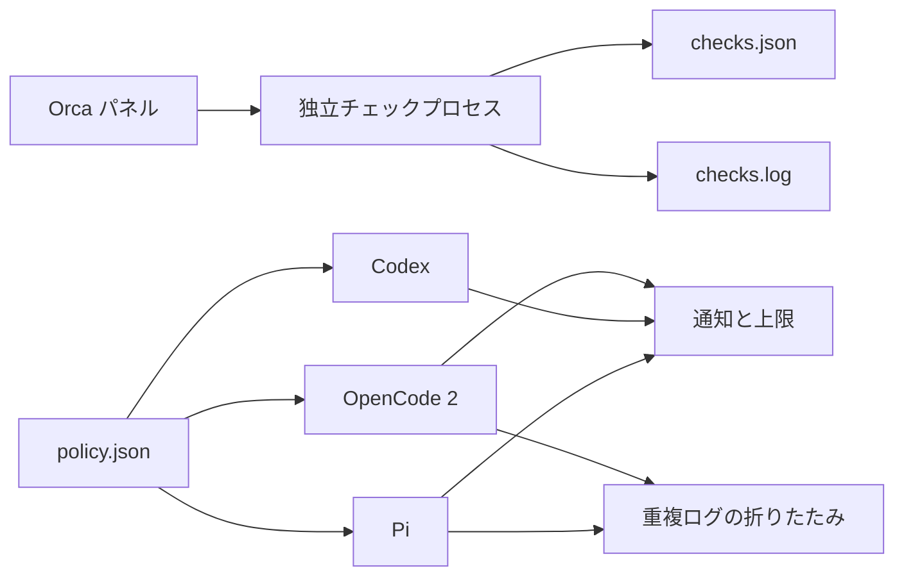

# HarnessPro

**OpenCode 2、Codex、Pi でツール予算を共有し、Orca からチェックを実行します。**

[English](../../README.md) · [简体中文](zh-CN.md) · **日本語**

## 3 つのエージェントがリポジトリを訪れました

1 つ目は同じファイルを 12 回読みました。2 つ目は小説のように長いビルドログをダウンロードしました。3 つ目はテストが通った後もツールを呼び続けました。

HarnessPro は、3 つのエージェントに共通の予算を設定します。上限に近づくと終了を促し、上限に達すると後続の呼び出しを止めます。Orca のパネルからチェックを実行できるため、ターミナルを見続ける必要はありません。

このプロジェクトは HarnessPro 論文に着想を得たサードパーティ実装です。論文著者の公式実装ではなく、論文のベンチマーク結果を主張するものでもありません。

## ツールボックスの中身

| コンポーネント | 現在の機能 | 現在の制約 |
| --- | --- | --- |
| Orca プラグイン | チェックの開始・状態表示・停止、完了通知 | プラグイン API は experimental です |
| 共有ポリシー | Lite、Medium、Heavy の 3 段階のツール予算 | プロファイルの自動選択には対応していません |
| OpenCode 2 アダプター | 段階通知、上限停止、重複ログの折りたたみ | 自動モデルルーティングには対応していません |
| Codex アダプター | 段階通知、上限停止、並列呼び出しの集計 | Codex Hook はツール出力を書き換えられないため、ログの折りたたみはありません |
| Pi アダプター | 段階通知、上限停止、ログの折りたたみ、セッション内の切り替え | 自動モデルルーティングには対応していません |

要するに、無駄な探索を減らし、完了まで進みやすくするプロジェクトです。

## 30 秒クイックスタート

### 要件

- Linux
- Node.js 22 以上
- Python 3.12 以上
- Orca 1.4.0 以上
- 必要に応じて OpenCode 2、Codex、Pi

### インストール

1. リポジトリをクローンし、テスト依存関係をインストールします。

   ```bash
   git clone git@github.com:wzasd/HarnessPro.git
   cd HarnessPro
   npm install
   ```

2. プラグインとアダプターをリンクします。

   ```bash
   npm run install:local
   ```

3. Orca で「設定 → Plugins」を開きます。
4. プラグイン一覧を更新し、要求される権限を確認します。
5. HarnessPro を有効にします。

インストーラーは既存ファイルをバックアップしてからシンボリックリンクを作成します。バックアップの suffix は `.backup-before-project` と `.backup-before-harnesspro-project` です。

## 予算プロファイルを選択する

エージェントの起動時にプロファイルを指定します。

```bash
harnesspro lite opencode2 --standalone
harnesspro medium codex
harnesspro heavy pi
```

| プロファイル | Economy | Convergence | 上限 | 最初の目安 |
| --- | ---: | ---: | ---: | --- |
| Lite | 8 | 14 | 22 | 範囲の明確な小さなタスク |
| Medium | 14 | 26 | 44 | 通常のコーディング作業 |
| Heavy | 20 | 36 | 60 | 難しい調査や修正 |

これらはローカルの初期値であり、論文の推奨値ではありません。実際のタスクで成功率とコストを記録して調整してください。

Pi ではセッション中にも切り替えられます。

```text
/harnesspro lite
/harnesspro medium
/harnesspro heavy
/harnesspro off
```

プロファイルを選択しない場合、予算制限は無効です。

## Orca からチェックを実行する

パネルのボタン、または次のコマンドを使用します。

```bash
harnesspro checks start
harnesspro checks status
harnesspro checks stop
```

チェックは独立したプロセスで実行されます。パネルを閉じても停止しません。

```text
~/.local/state/harnesspro/checks.json
~/.local/state/harnesspro/checks.log
```

## 構成



プラグインコード、ポリシー、ジョブ記録は別々に保存されます。プラグインを更新しても、ポリシーやログは削除されません。

## 論文の出典

プロジェクト名と予算プロファイルの考え方は、次の論文に由来します。

**HarnessPro: Recursive Harness Self-Improvement with Pareto Optimization for Performance-Cost Trade-offs**

- **著者**：Zhuoshi Pan、ZhiYuan Feng、Yukuo Cen、Honglin Lin、Junru Lu、Zhongxia Chen、Shuo Yang、H. Vicky Zhao、Jie Tang
- **論文**：[arXiv:2610.26770v2](https://arxiv.org/abs/2610.26770v2)、2026-10-20 公開
- **DOI**：[10.48550/arXiv.2610.26770](https://doi.org/10.48550/arXiv.2610.26770)
- **状態**：Under review
- **公式コード**：[pzs19/HarnessPro](https://github.com/pzs19/HarnessPro)

| 出典 | 内容 |
| --- | --- |
| 論文 | ラベル不要のテスト合成、マルチエージェント Harness 進化、性能とコストのパレート選択 |
| 公式リポジトリ | 3 つのベンチマーク向けの 9 種類の Harness アーティファクトと評価コード |
| このリポジトリ | Orca プラグイン、共有予算、エージェントアダプター、チェックコーディネーター |

論文では Lite、Medium、Heavy を性能とコストの動作点として使用します。このリポジトリでは、同じ名前をツール予算プロファイルにのみ使用します。論文のパレートフロンティアや実験結果を再現したものではありません。

## Marketplace からインストールする

1. Orca で「設定 → Plugins → Marketplace sources」を開きます。
2. 次の Git URL を追加します。

   ```text
   https://github.com/wzasd/HarnessPro.git
   ```

3. ref を `main` に設定します。
4. `harnesspro.orca` をインストールし、権限を確認します。
5. プラグインを有効にします。

Marketplace インデックスは現在 `v0.1.0` を指しています。

## 更新

ローカルのシンボリックリンク安装では、次のコマンドだけで更新できます。

```bash
git pull
npm install
npm test
```

リンクはプロジェクトを指したままなので、インストールを再実行する必要はありません。

Marketplace 安装では、Orca で更新を確認する必要があります。ポリシーとジョブ記録は、バージョン管理されたプラグインディレクトリの外に保存されます。

## 開発

### プロジェクト構成

```text
orca-plugin.json       Orca マニフェスト
orca-marketplace.json  Marketplace インデックス
main.mjs               Orca worker
panel.html             Orca パネル
coordinator.mjs        独立チェックプロセス
core.mjs               OpenCode 2 と Pi の共通ロジック
policy.json            共有予算
adapters/              OpenCode 2、Codex、Pi アダプター
scripts/               ローカルインストールと登録
```

### テスト

```bash
npm test
```

テストは、ポリシー読み込み、並列集計、ログの折りたたみ、プロセスのライフサイクル、Orca worker、Codex Hook の入出力、旧 Hook パスの移行をカバーします。

### 新しいバージョンを公開する

1. `package.json` と `orca-plugin.json` のバージョンを更新します。
2. `orca-marketplace.json` の ref を更新します。
3. `npm test` を実行します。
4. 変更をコミットし、同じ名前の Git タグを作成します。
5. コミットとタグを GitHub に push します。

## まだ含まれていない機能

- モデルと reasoning effort の自動ルーティング。
- マルチエージェントによる軌跡分析、計画、編集、テスト合成。
- 固定タスクセットとコストを使った候補評価。
- 現在のポリシーの自動置き換え。

これらは HarnessPro の研究方向に含まれる機能です。このリポジトリは、予算とオーケストレーションの基盤を提供するもので、完全な自己進化ループではありません。

## その他の言語

- [English](../../README.md)：正規のメンテナンス版
- [简体中文](zh-CN.md)
- **日本語**

英語版が情報の基準です。動作やセットアップを変更する場合は、同じ Pull Request で翻訳も更新してください。

## License

[MIT](../../LICENSE)
