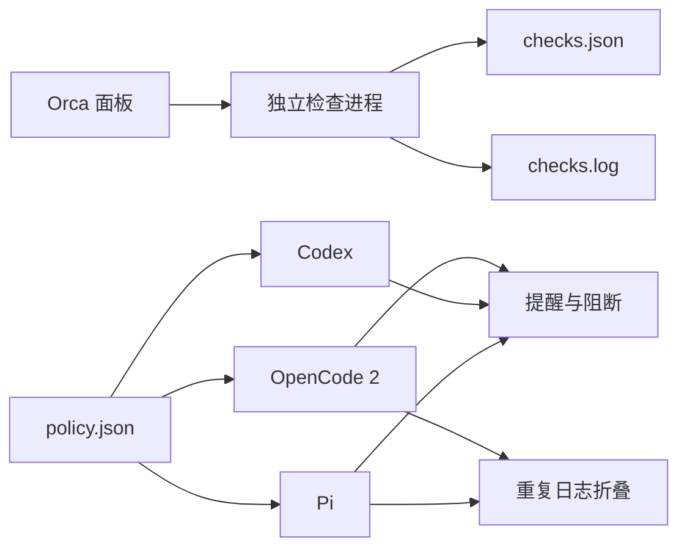

# HarnessPro

**让 OpenCode 2、Codex 和 Pi 共用工具预算，并在 Orca 中运行检查。**

[English](../../README.md) · **简体中文** · [日本語](ja.md)

## 3 个 Agent 走进一个仓库

第 1 个 Agent 把同一个文件读了 12 遍。第 2 个 Agent 下载了小说一样长的构建日志。第 3 个 Agent 在测试通过后仍继续调用工具。

HarnessPro 给这 3 个 Agent 设置同一套预算。接近上限时，HarnessPro 会提醒 Agent 收尾。达到上限后，HarnessPro 会阻断后续调用。你也可以通过 Orca 面板运行检查，不必一直盯着终端。

本项目是参考 HarnessPro 论文开发的第三方工程项目。本仓库不是论文作者维护的官方仓库，也不宣称取得论文中的基准结果。

## 工具箱里有什么

| 组件 | 当前功能 | 当前边界 |
| --- | --- | --- |
| Orca 插件 | 运行检查、查看状态、停止检查、显示完成通知 | 插件 API 仍处于实验阶段 |
| 共享策略 | Lite、Medium、Heavy 3 档工具预算 | 支持关键词自动路由，也可手动覆盖 |
| OpenCode 2 适配器 | 阶段提醒、超限阻断、重复日志折叠 | 模型映射保存在 `policy.json` |
| Codex 适配器 | 阶段提醒、超限阻断、并行调用计数 | 官方 Hook 不支持改写工具结果，不能折叠日志 |
| Pi 适配器 | 阶段提醒、超限阻断、重复日志折叠、会话内切换 | 模型映射保存在 `policy.json` |

简单说：减少无效探索，及时完成任务。

## 30 秒快速开始

### 环境要求

- Linux。
- Node.js 22 或更高版本。
- Python 3.12 或更高版本。
- Orca 1.4.0 或更高版本。
- 按需安装 OpenCode 2、Codex 或 Pi。

### 安装

1. 克隆项目并安装测试依赖：

   ```bash
   git clone git@github.com:wzasd/HarnessPro.git
   cd HarnessPro
   npm install
   ```

2. 链接插件和适配器：

   ```bash
   npm run install:local
   ```

3. 打开 Orca 的“设置 → Plugins”。
4. 选择“从本地路径安装”，再选择当前项目目录。
5. 查看权限说明并启用 HarnessPro。

安装脚本会备份已有文件，再创建符号链接。备份后缀为 `.backup-before-project` 和 `.backup-before-harnesspro-project`。

## 选择明确的预算

启动 Agent 前选择档位：

```bash
harnesspro lite opencode2 --standalone
harnesspro medium codex
harnesspro heavy pi
```

| 档位 | Economy | Convergence | 工具上限 | 适用起点 |
| --- | ---: | ---: | ---: | --- |
| Lite | 8 | 14 | 22 | 范围明确的小任务 |
| Medium | 14 | 26 | 44 | 日常编码任务 |
| Heavy | 20 | 36 | 60 | 困难排查任务 |

这些数值是本地初始值，不是论文推荐值。修改前宜记录真实任务的通过率和成本。

Pi 会话内也可以切换：

```text
/harnesspro lite
/harnesspro medium
/harnesspro heavy
/harnesspro off
```

未选择档位时，预算限制默认关闭。

### 自动模型路由

让路由器根据任务描述选择模型和预算：

```bash
harnesspro auto --task "Fix a typo in the README" pi
harnesspro auto --task "Add parser tests" codex
harnesspro auto --task "Debug a production race condition" opencode2 --standalone
```

当前路由器使用确定性关键词。任务描述为空时默认使用 Medium。关键词路由只是备用方案，不是经过基准验证的分类器。依赖自动路由前，宜先检查真实任务的选择结果。

## 在 Orca 中运行检查

使用面板按钮，或在终端执行：

```bash
harnesspro checks start
harnesspro checks status
harnesspro checks stop
```

检查在独立进程中运行。关闭面板不会停止检查。

```text
~/.local/state/harnesspro/checks.json
~/.local/state/harnesspro/checks.log
```

## 多 Agent 进化

启动由 Orca 协调的真实进化任务：

```bash
harnesspro evolve start
harnesspro evolve status
harnesspro evolve stop
```

协调器使用测试合成、轨迹分析、进化规划、Harness 编辑 4 个 Orca worker。候选随后运行真实 Codex 验证，并使用同一组固定测试。报告包含通过率、耗时和 Token 成本，不虚构美元估算。

状态变为 `awaiting-approval` 后，审核报告并显式选择档位：

```bash
harnesspro evolve apply medium
```

只有执行 `apply` 才会替换共享策略。

## 工作方式



插件代码、策略和任务记录分开保存。更新插件不会删除策略或日志。

## 论文来源

项目名称和预算档位的思路来自以下论文：

**HarnessPro: Recursive Harness Self-Improvement with Pareto Optimization for Performance-Cost Trade-offs**

- **作者**：Zhuoshi Pan、ZhiYuan Feng、Yukuo Cen、Honglin Lin、Junru Lu、Zhongxia Chen、Shuo Yang、H. Vicky Zhao、Jie Tang。
- **论文**：[arXiv:2610.26770v2](https://arxiv.org/abs/2610.26770v2)，发布于 2026-10-20。
- **DOI**：[10.48550/arXiv.2610.26770](https://doi.org/10.48550/arXiv.2610.26770)。
- **状态**：Under review。
- **官方代码**：[pzs19/HarnessPro](https://github.com/pzs19/HarnessPro)。

| 来源 | 主要内容 |
| --- | --- |
| 论文 | 无标签测试合成、多 Agent Harness 进化、性能与成本帕累托选择 |
| 官方仓库 | 3 个基准的 9 套 Harness 配置和评测代码 |
| 本仓库 | Orca 插件、共享预算、Agent 适配器和检查协调器 |

论文使用 Lite、Medium、Heavy 表示不同的性能与成本取舍。本仓库目前只用这些名称表示工具预算档位，不表示已经复现论文的帕累托前沿或实验结果。

## 通过 Marketplace 安装

1. 打开 Orca 的“设置 → Plugins → Marketplace sources”。
2. 添加 Git 地址：

   ```text
   https://github.com/wzasd/HarnessPro.git
   ```

3. 将 ref 设为 `main`。
4. 安装 `harnesspro.orca` 并查看权限说明。
5. 启用插件。

Marketplace 当前指向 `v0.2.0`。

## 更新

本地链接安装只需要拉取新代码：

```bash
git pull
npm install
npm test
```

符号链接会继续指向项目目录。无需重复运行安装脚本。

Marketplace 安装需要在 Orca 中确认更新。策略和任务记录不会随版本切换删除。

## 开发

### 项目结构

```text
orca-plugin.json       Orca 插件清单
orca-marketplace.json  Marketplace 索引
main.mjs               Orca worker
panel.html             Orca 面板
coordinator.mjs        独立检查进程
router.mjs             任务分类和模型路由
evolution.mjs          多 Agent 进化协调器
evolution-core.mjs     候选评分和测试隔离
core.mjs               OpenCode 2 和 Pi 共用逻辑
policy.json            共享预算
adapters/              OpenCode 2、Codex、Pi 适配器
scripts/               本地安装和注册脚本
```

### 运行检查

```bash
npm test
```

检查覆盖策略读取、并行计数、日志折叠、进程生命周期、Orca worker、Codex Hook 输入输出和旧 Hook 路径迁移。

### 发布新版本

1. 更新 `package.json` 和 `orca-plugin.json` 的版本号。
2. 更新 `orca-marketplace.json` 中的 ref。
3. 运行 `npm test`。
4. 提交变更并创建同名 Git 标签。
5. 将提交和标签推送到 GitHub。

## 当前限制

- 路由器使用关键词，不是经过基准验证的分类器。
- 替换当前策略仍需要人工确认。
- 内置进化任务只是小型冒烟测试，不是论文基准。
- 本仓库没有复现论文的完整训练过程和报告结果。

## 其他语言

- [English](../../README.md)：维护入口。
- **简体中文**。
- [日本語](ja.md)。

英文主页是事实维护入口。行为或安装方式变化时，必须在同一个 Pull Request 中更新译文。

## License

[MIT](../../LICENSE)
